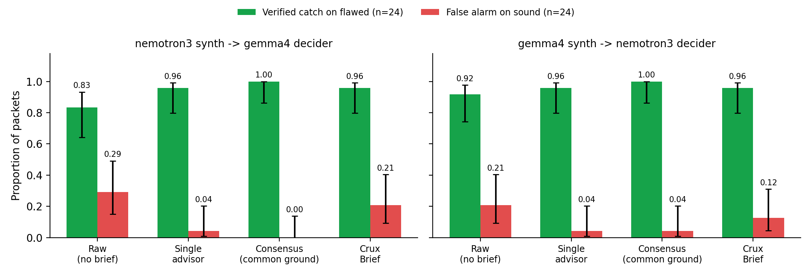
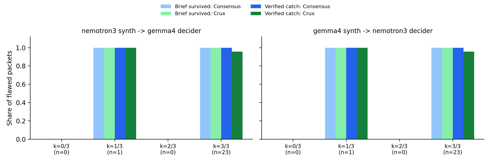

# When Structured Disagreement Backfires: Pre-Registered Evaluation of Crux Briefs vs. Common-Ground Summaries Under Saturated Advisory Panels

Kenny Wang, Independent Researcher. With Apart Research.

Track 3: Epistemic Products — Apart Research AI x Epistemics Research Sprint (13–15 November 2026)

Code, run records, tables, and hypothesis lock: https://github.com/cirwel/crux-brief (pre-registration lock commit `25d8afa`)

## Abstract

AI assistants evaluating consequential decision packets often alternate between unwarranted acquiescence and miscalibrated over-caution. Inspired by the "Angels-on-the-Shoulder" vision, we built `crux_brief`, a local multi-family briefing CLI and HTML Crux Card generator, and evaluated it in a pre-registered, blinded benchmark (24 paired flawed/sound scenarios across four domains; 816 total inference calls). Using three model families as Stage-1 advisors and cross-family synthesizer/decider pairings (plus a same-model ablation), we compared unbriefed decisions (`raw`), one advisor (`single`), a common-ground summary (`consensus`), and structured disagreement cards (`crux`). All briefed arms improved paired twin accuracy over `raw`, which exhibited high sound false-alarm rates (0.21–0.29); `crux` outperformed `raw` (McNemar b = 10, c = 1; pooled exact p = 0.0117; scenario-level sign p = 0.0215). However, strong Stage-1 panels saturated on flawed detection (23/24 unanimous detections, leaving only one split scenario for evaluating minority rescue), isolating the cost side of disagreement surfacing. Contrary to prediction, `consensus` outperformed `crux` in cross-family twin accuracy (1.00 and 0.96 vs. 0.79 and 0.88; pooled b = 1, c = 8, nominal p = 0.0391; scenario-level b = 0, c = 6, p = 0.0312) because `crux` incurred higher sound false alarms (0.21 and 0.12 vs. 0.00 and 0.04). Qualitative trace analysis isolates minority false-alarm amplification, unverified-premise leakage on unanimous `proceed` panels, and secondary arithmetic distraction—motivating programmatic threshold gating and deterministic verification for epistemic warning tools.

## 1 Introduction

Decision makers who review job offers, leases, invoices, or operational metrics with an AI assistant face paired epistemic hazards: sycophantic deferral when the user leans toward proceeding (Cheng et al., 2026; Fanous et al., 2025), divergence between stated assurance and underlying accuracy (Ren et al., 2025), and brittle arithmetic when unassisted models skim a packet. Multi-agent debate offers one verification mechanism (Du et al., 2023), while deliberative mediation tools inspired by the Habermas Machine synthesize viewpoints around common ground (Tessler et al., 2024). Yet the "Angels-on-the-Shoulder" design agenda (Cotton-Barratt, Vaintrob, Sourbut, & Hadshar, 2026; Cotton-Barratt & Finnveden, 2026) highlights a potential failure mode of consensus summaries: if one advisor detects a buried constraint violation that peers overlook, smoothing into common ground could bury the warning.

We built `crux_brief`, a Track 3 briefing product, and evaluated whether preserving structured two-sided *cruxes* (`crux`) catches more premise defects than unbriefed decisions (`raw`), a single advisor (`single`), or a deliberative common-ground prompt (`consensus`) without excessive false alarms on paired sound controls (24 pairs = 48 packets across four domains). In practice, strong 27B–33B open-weight advisors saturated flawed detection (23/24 unanimous 3/3 detections), turning our experiment primarily into a test of **false-alarm calibration under agreement**. Under those conditions, all advisory briefs substantially reduced the high false-hold rate of unbriefed `raw` decisions (21%–29%), whereas `crux` trailed `consensus` on paired twin accuracy due to elevated sound false alarms.

Our contributions are: (1) an open-weight Track 3 CLI and HTML Crux Card generator (`crux_brief`); (2) a blinded cross-family evaluation harness isolating Stage-2 synthesizers from raw `packet_text`; (3) pre-registered empirical results showing `consensus` beating `crux` (p = 0.0312 at the scenario cluster level) while split-panel benefit remained underpowered (n = 1); and (4) qualitative trace forensics isolating three candidate failure patterns that motivate deterministic calculation checks and programmatic gating.

## 2 Product Architecture and Pre-Registered Methodology

### 2.1 `crux_brief` CLI and HTML Crux Card

Given a decision packet and explicit user constraints, `crux_brief` queries three distinct open-weight families locally via Ollama (`gemma4:latest`, `qwen3.6:27b-coding-mxfp8`, `nemotron3:33b`, unloading models via `keep_alive: 0` between stages) and synthesizes a JSON Crux structure (`shared_ground`, `cruxes` containing `topic`/`side_a`/`side_b`/`premise_at_stake`, `unverified_premises`, and `decisive_check`). Rendered HTML cards (`examples/sample_brief.html`, 152 words; `examples/sample_brief_triage.html`, 154 words) display per-advisor `proceed`/`hold_to_verify` pills, side-by-side `Side A / Side B` disagreement blocks, the blinded text brief, and an optional `--compare-consensus` baseline.

### 2.2 Benchmark Suite and Experimental Controls

Pre-registered hypotheses and analysis rules were locked locally on branch `main` in `HYPOTHESES.md` (`25d8afa`, committed locally prior to running `runs/full` and published to GitHub afterward; post-lock chart and publication metadata edits are logged in `HYPOTHESES.md` and Appendix C). The benchmark contains 24 paired scenarios (`S01`–`S24`, 48 packets) spanning `job_offers`, `leases`, `procurement_handoffs`, and `operational_briefs` (6 pairs each). Each pair shares `constraints` and differs by one planted defect (`packet_flawed`, scored against domain `oracle_markers`) versus a repaired sound control (`packet_sound`), constrained by unit tests (8/8 passing) to normalized word-length parity <= 0.16 and zero giveaway tokens.

Following Checkpoint 1 cross-family critique (Appendix C), we implemented five controls: (1) `single` rotates outputs from the same 3-model Stage-1 panel (`T = 0.3`, `seed = 0`, `think = False`, `format = "json"`); (2) Stage-2 `format_panel_input` excludes `packet_text` completely and shuffles anonymized advisors; (3) prompt calibration ordered `summary`/`key_claims` before `recommendation`/`risks_or_flaws` with anti-pedantry rules (`ADVISOR_SYSTEM`), explicitly instructed `CRUX_SYSTEM` to leave `cruxes = []` and `unverified_premises = []` on unanimous `proceed` panels, and hardened `CONSENSUS_SYSTEM` (a single-turn common-ground prompt inspired by deliberative mediation, not the full iterative Habermas Machine pipeline) to retain explicit minority technical objections (`runs/smoke_calibration_v3` verified 1/4 sound FA on both cross-family deciders and 50.35s mean / 72.89s max `qwen3.6` latency before lock); (4) `single`, `consensus`, and `crux` render through identical neutral headers (`ASSESSMENT OVERVIEW:`, `POINTS OF NOTE:`, `SUGGESTED NEXT STEP:`, capped at 220 words); and (5) primary evaluations cross synthesizer and decider families (`nemotron3 -> gemma4`, `gemma4 -> nemotron3`, with `qwen3.6` strictly in Stage 1), alongside a same-model `gemma4 -> gemma4` ablation reusing `gemma4` Stage-2 briefs and `raw`/`single` baselines (144 Stage-1 + 192 Stage-2 + 384 cross-family Stage-3 + 96 ablation Stage-3 = 816 calls; 132.3 min cumulative inference).

### 2.3 Metrics, Hypotheses, and Statistical Scope

Flawed and sound packets are never pooled. A **missed** flawed packet is `action == "proceed"`, distinct from an **untargeted hold** (`hold_to_verify` without `oracle_markers` match in `primary_reason` + `target_clause_or_metric`) and a **verified catch** (`hold_to_verify` + `oracle_markers` match). On `packet_sound`, `hold_to_verify` is a **sound false alarm (FA)**. At the twin level (n = 24 pairs per decider), **paired twin accuracy** holds iff `packet_flawed` is a verified catch AND `packet_sound` is `proceed`; **Net J** equals `verified catch rate - sound FA rate` (rates rounded half-to-even to two decimal places matching `results/tables.md`). Locked hypotheses evaluated whether `crux` beats `raw`/`single` (**H1**), outperforms `consensus` on split panels k in {1, 2} (**H2**), restrains sound FAs to maintain superior twin accuracy and Net J (**H3**), and explores same-model coupling plus missed-flaw comfort gaps (**H4**). Pre-registered inference in `results/tables.md` reports 95% Wilson CIs and two-sided exact McNemar tests (b = `crux_only`, c = `other_only`) per pairing (n = 24) and pooled across both cross-family deciders (n = 48). Because n = 48 clusters two deciders over the same 24 scenarios and Table 2 spans 9 pooled tests (neither 0.0117 nor 0.0391 survives Holm adjustment), we supplement `results/tables.md` with post-hoc exact scenario-level sign tests (n = 24 independent scenario twins, scoring each scenario 0/1/2 by deciders correct) and mark secondary comparisons (`vs. raw`) as post-hoc.

## 3 Empirical Results

Across 144 Stage-1 calls (Table 1), all three advisor families approached ceiling on flawed packets: `qwen3.6` caught 24/24 (0/24 FA), while `nemotron3` (0/24 FA) and `gemma4` (3/24 FA) each caught 23/24, both missing only `S20_flawed` (a cohort denominator-exclusion trap). Consequently, 23/24 flawed packets saturated at k = 3/3, leaving only 1/24 (`S20_flawed`) in the split-panel stratum (k = 1/3). On sound packets, 21/24 received unanimous Stage-1 `proceed` recommendations, while 3/24 (`S04_sound`, `S08_sound`, `S09_sound`) drew a solitary `hold_to_verify` from `gemma4`.

| Advisor model | Flawed verified catch | Flawed raw holds | Sound false alarms | Stage-1 latency (post-hoc) |
|---|---|---|---|---|
| `qwen3.6:27b-coding-mxfp8` | 24/24 = 1.00 [0.86, 1.00] | 24/24 | 0/24 = 0.00 [0.00, 0.14] | mean 54.54s (max 80.10s) |
| `nemotron3:33b` | 23/24 = 0.96 [0.80, 0.99] | 23/24 | 0/24 = 0.00 [0.00, 0.14] | mean 9.52s (max 12.91s) |
| `gemma4:latest` | 23/24 = 0.96 [0.80, 0.99] | 23/24 | 3/24 = 0.12 [0.04, 0.31] | mean 10.70s (max 20.59s) |

: Table 1: Stage-1 independent advisor accuracy (`results/tables.md`; n = 24 flawed, n = 24 sound, 95% Wilson CI). Flawed split counts: k=0: 0/24, k=1: 1/24 (`S20`), k=2: 0/24, k=3: 23/24.

<figure>

<figcaption><strong>Figure 1.</strong> Cross-family Stage-3 verified catch on flawed packets (green, n = 24) and false alarms on paired sound controls (red, n = 24) with 95% Wilson CIs. Unbriefed <code>raw</code> deciders over-hold on clean packets (0.29 and 0.21), while <code>consensus</code> dominates <code>crux</code> on sound false-alarm restraint.</figcaption>
</figure>

Tables 2a and 2b (and Figure 1) summarize Stage-3 cross-family outcomes across 48 packets per decider (96 packet-level evaluations across both cross-family deciders = 384 decisions across 4 arms). Unbriefed `raw` deciders struggled primarily with over-holding on sound controls (7/24 = 0.29 on `gemma4`, 5/24 = 0.21 on `nemotron3`) alongside catching 20/24 and 22/24 flawed packets (missing 4/24 and 2/24, with 2/24 untargeted holds on `gemma4`). Adding any advisory brief raised paired twin accuracy substantially: on scenario-level sign tests (n = 24 independent scenarios, post-hoc), `consensus` beat `raw` (b = 12, c = 0, p = 0.0005), `single` beat `raw` (b = 10, c = 1, p = 0.0117), and `crux` beat `raw` (b = 9, c = 1, p = 0.0215; pooled McNemar b = 10, c = 1, nominal p = 0.0117).

| Synth -> Decider | Arm | Flawed verified catch | Untargeted hold | Sound false alarm | Paired twin acc. | Net J |
|---|---|---|---|---|---|---|
| `nemotron3` -> `gemma4` | `raw` | 20/24 = 0.83 [0.64, 0.93] | 2/24 = 0.08 | 7/24 = 0.29 [0.15, 0.49] | 14/24 = 0.58 [0.39, 0.76] | +0.54 |
| `nemotron3` -> `gemma4` | `single` | 23/24 = 0.96 [0.80, 0.99] | 0/24 = 0.00 | 1/24 = 0.04 [0.01, 0.20] | 22/24 = 0.92 [0.74, 0.98] | +0.92 |
| `nemotron3` -> `gemma4` | `consensus` | 24/24 = 1.00 [0.86, 1.00] | 0/24 = 0.00 | 0/24 = 0.00 [0.00, 0.14] | 24/24 = 1.00 [0.86, 1.00] | +1.00 |
| `nemotron3` -> `gemma4` | `crux` | 23/24 = 0.96 [0.80, 0.99] | 1/24 = 0.04 | 5/24 = 0.21 [0.09, 0.40] | 19/24 = 0.79 [0.60, 0.91] | +0.75 |
| `gemma4` -> `nemotron3` | `raw` | 22/24 = 0.92 [0.74, 0.98] | 0/24 = 0.00 | 5/24 = 0.21 [0.09, 0.40] | 17/24 = 0.71 [0.51, 0.85] | +0.71 |
| `gemma4` -> `nemotron3` | `single` | 23/24 = 0.96 [0.80, 0.99] | 0/24 = 0.00 | 1/24 = 0.04 [0.01, 0.20] | 22/24 = 0.92 [0.74, 0.98] | +0.92 |
| `gemma4` -> `nemotron3` | `consensus` | 24/24 = 1.00 [0.86, 1.00] | 0/24 = 0.00 | 1/24 = 0.04 [0.01, 0.20] | 23/24 = 0.96 [0.80, 0.99] | +0.96 |
| `gemma4` -> `nemotron3` | `crux` | 23/24 = 0.96 [0.80, 0.99] | 1/24 = 0.04 | 3/24 = 0.12 [0.04, 0.31] | 21/24 = 0.88 [0.69, 0.96] | +0.83 |

: Table 2a: Cross-family Stage-3 decision outcomes (`results/tables.md`; 95% Wilson CIs; sensitivity on any hold on flawed packets: `crux` = 24/24 on both deciders because `S15_flawed` held without oracle-marker match).

| Scope / Contrast | Flawed verified catch (b, c; p) | Sound false alarm (b, c; p) | Paired twin accuracy (b, c; p) |
|---|---|---|---|
| `nemotron3 -> gemma4`: `crux vs. raw` | b=3, c=0 (0.2500) | b=2, c=4 (0.6875) | b=6, c=1 (0.1250) |
| `nemotron3 -> gemma4`: `crux vs. single` | b=1, c=1 (1.0000) | b=5, c=1 (0.2188) | b=2, c=5 (0.4531) |
| `nemotron3 -> gemma4`: `crux vs. consensus` | b=0, c=1 (1.0000) | b=5, c=0 (0.0625) | b=0, c=5 (0.0625) |
| `gemma4 -> nemotron3`: `crux vs. raw` | b=2, c=1 (1.0000) | b=1, c=3 (0.6250) | b=4, c=0 (0.1250) |
| `gemma4 -> nemotron3`: `crux vs. single` | b=1, c=1 (1.0000) | b=2, c=0 (0.5000) | b=1, c=2 (1.0000) |
| `gemma4 -> nemotron3`: `crux vs. consensus` | b=0, c=1 (1.0000) | b=3, c=1 (0.6250) | b=1, c=3 (0.6250) |
| Pooled (n=48): `crux vs. raw` / `single` / `consensus` | 5,1 (.2188); 2,2 (1.0); 0,2 (.50) | 3,7 (.3438); 7,1 (.0703); 8,1 (.0391) | 10,1 (.0117); 3,7 (.3438); 1,8 (.0391) |
| Scenario-level (n=24, post-hoc): `crux vs. raw` / `cons` | — | b=2, c=6 (.2891) / b=6, c=0 (.0312) | b=9, c=1 (.0215) / b=0, c=6 (.0312) |
| Secondary post-hoc (n=48 / n=24): `consensus vs. raw` | b=6, c=0 (.0312 pooled) | b=0, c=9 (.0039 scenario) | 16,0 (<.0001 pooled); 12,0 (.0005 scen.) |

: Table 2b: Pre-registered exact McNemar discordant counts (b = `crux_only`, c = `other_only` in `results/tables.md`) plus post-hoc scenario-level cluster sign tests (n = 24) and secondary `consensus vs. raw` contrasts (`single vs. raw` post-hoc: b = 14, c = 1, p = 0.0010 pooled; b = 10, c = 1, p = 0.0117 scenario-level).

Evaluating the four pre-registered hypotheses strictly against Tables 1–3 yields:
- **H1 (half supported):** `crux` beat `raw` on paired twin accuracy (p = 0.0215 scenario-level, nominal p = 0.0117 pooled), but did not beat `single` (b = 3, c = 7, p = 0.3438), trending worse on FAs (b = 7, c = 1, p = 0.0703).
- **H2 (not evaluable; n = 1 tie):** Stage-1 saturation left only `S20_flawed` at k = 1/3 (Figure 2). Both `consensus` and `crux` preserved `qwen3.6`'s 52.8% (740/1,400) catch (1/1) and rescued both deciders (1/1 vs. 0/1 for `single`, where both pairings drew `nemotron3`, and `raw`, which returned `proceed`), whereas neither `S20` nor any k = 2/3 case separated `crux` from `consensus`.
- **H3 (reversed vs. `consensus`):** Because flawed catches were near ceiling, sound FA separation drove twin accuracy and Net J (0/24 and 1/24 for `consensus` vs. 5/24 and 3/24 for `crux`). Every scenario-level discordant twin (b = 0, c = 6, p = 0.0312) and sound FA (b = 6, c = 0, p = 0.0312) favored `consensus` over `crux` (pooled nominal p = 0.0391).
- **H4 (ablation & comfort gap uninformative at ceiling):** Same-model `gemma4 -> gemma4` differed from cross-family `nemotron3 -> gemma4` by one FA per arm (`consensus` 0 -> 1, `crux` 5 -> 6, Table 3b), without a formal difference test. Brief endorsement saturated (4.90–5.00), and missed-flaw 100% confidence / 5.00 endorsement checks rest on n = 1 (`single`) to n = 2 (`raw`) packets per decider.

<figure>

<figcaption><strong>Figure 2.</strong> Stage-2 flaw survival and Stage-3 catch stratified by Stage-1 panel detection count k. Near-ceiling Stage-1 panels concentrated 23/24 scenarios at k = 3/3; on the sole split scenario (<code>S20_flawed</code>, k = 1/3), both <code>consensus</code> and <code>crux</code> survived and caught the flaw.</figcaption>
</figure>

Table 3a mirrors Figure 2 across the 24 sound packets (post-hoc). Whereas `single` and `consensus` never false-held on any of the 21 unanimous Stage-1 `proceed` sound packets (0/21 across all pipelines), `crux` false-held on 2/21–3/21 unanimous sound packets and amplified 1-of-3 Stage-1 false holds (`S04`, `S08`, `S09`) in 1/3 to 3/3 cases. Notice also (Table 3b) that `crux` briefs were substantially shorter than `consensus` briefs (100 vs. 154 median words on `gemma4`; 124 vs. 180 on `nemotron3`), indicating that the length-matching cap allowed an unintended length asymmetry in the opposite direction—leaving `crux` less rationale space around benign items.

| Pipeline (post-hoc sound split) | `raw` unan. / split | `single` unan. / split | `consensus` unan. / split | `crux` unan. / split |
|---|---|---|---|---|
| Cross: `nemotron3 -> gemma4` | 6/21 / 1/3 | 0/21 / 1/3 | 0/21 / 0/3 | 3/21 (`S15,17,19`) / 2/3 (`S08,09`) |
| Cross: `gemma4 -> nemotron3` | 3/21 / 2/3 | 0/21 / 1/3 | 0/21 / 1/3 (`S09`) | 2/21 (`S15,24`) / 1/3 (`S04`) |
| Same: `gemma4 -> gemma4` | 6/21 / 1/3 | 0/21 / 1/3 | 0/21 / 1/3 (`S09`) | 3/21 (`S13,15,24`) / 3/3 (`S04,08,09`) |

: Table 3a: Sound false alarms stratified by whether Stage-1 advisors voted unanimously `proceed` (21/24) versus 1-of-3 `hold_to_verify` (`S04`, `S08`, `S09`; 3/24), computed post-hoc from `runs/full`.

| Pairing / Scope | Arm | Median words | Median s (`synth+dec`) | Verified catch | Sound FA | Paired twin acc. | Net J | Endorse |
|---|---|---|---|---|---|---|---|---|
| Cross: `nemotron3 -> gemma4` | `consensus` | 154 | 13.8 | 24/24 (1.00) | 0/24 (0.00) | 24/24 (1.00) | +1.00 | 5.00 |
| Cross: `nemotron3 -> gemma4` | `crux` | 100 | 12.2 | 23/24 (0.96) | 5/24 (0.21) | 19/24 (0.79) | +0.75 | 4.90 |
| Cross: `gemma4 -> nemotron3` | `consensus` | 180 | 16.0 | 24/24 (1.00) | 1/24 (0.04) | 23/24 (0.96) | +0.96 | 5.00 |
| Cross: `gemma4 -> nemotron3` | `crux` | 124 | 15.0 | 23/24 (0.96) | 3/24 (0.12) | 21/24 (0.88) | +0.83 | 4.94 |
| Same: `gemma4 -> gemma4` | `consensus` | n/a | n/a | 24/24 (1.00) | 1/24 (0.04) | 23/24 (0.96) | +0.96 | 5.00 |
| Same: `gemma4 -> gemma4` | `crux` | n/a | n/a | 23/24 (0.96) | 6/24 (0.25) | 18/24 (0.75) | +0.71 | 5.00 |

: Table 3b: Brief length, latency (`synth+decide`), and same-model ablation (`results/tables.md` Tables 5–6; `ablation_same_model` reuses `gemma4` Stage-2 briefs — 180/124 median words — alongside `gemma4` `raw`/`single` baselines and executes 96 new `consensus`/`crux` Stage-3 calls). Domain breakdown (`results/tables.md` Table 4): `crux` FAs occurred across `leases` (2/6), `procurement_handoffs` (2/6), `operational_briefs` (1/6) on `gemma4`, and 1/6 each in `job_offers`, `procurement_handoffs`, `operational_briefs` on `nemotron3`.

## 4 Qualitative Trace Forensics and Design Implications

Inspecting the divergent packet traces across `runs/full` identifies three distinct candidate failure patterns behind `crux`'s excess holds, plus one decider arithmetic blunder:

1. **Minority False-Alarm Amplification (`S04_sound`, `S08_sound`, `S09_sound`):** On these three clean packets, `qwen3.6` and `nemotron3` recommended `proceed`, while only `gemma4` raised a Stage-1 hold (including a self-contradictory `"$328,000 ... is less than $280,000, although it is greater"` on `S04_sound`). Because Stage 2 was blinded to `packet_text`, `crux` could not check the claim independently and formatted the solitary objection into a balanced `Side A vs. Side B` dispute (2/3 FAs on `gemma4`, 1/3 on `nemotron3`, 3/3 same-model), whereas `consensus` discounted the 2-to-1 outlier more reliably (0/3 and 1/3).
2. **Unanimous-`proceed` Leakage (`S13_sound`, `S15_sound`, `S19_sound`, `S24_sound`):** Despite explicit prompt instructions to emit empty arrays when all advisors recommend `proceed`, Stage-2 `crux` leaked non-empty `unverified_premises` in 2/21 unanimous `proceed` packets under `nemotron3` synth (`S15`, `S19` -> 2/2 false holds on `gemma4`) and leaked 2/21 `cruxes` plus 3/21 `unverified_premises` under `gemma4` synth (`S13`, `S15`, `S24` -> 2/3 false holds on cross-family `nemotron3`, 3/3 on same-model `gemma4`; `nemotron3` still passed `S13_sound`). Every leaked item reflected non-pivotal intermediate calculation differences strictly inside the safe region (43.2 vs. 7.2 min downtime when < 60 min on `S13`; 360- vs. 365-day APR yielding positive savings on `S15`; $190k vs. $205k costs against $360k savings >= $100k on `S24`). Separately, on `S17_sound` (0 cruxes/flags), `gemma4` decider distrusted the shorter brief (endorsement 2/5) and misadded `$108,000 + $7,000 + $2,200 = $118,200` (actually $117,200), whereas the longer `consensus` brief explicitly carried the $117,200 sum.
3. **Secondary Disputes Obscuring Unanimous Holds (`S15_flawed`):** All three Stage-1 advisors caught negative net savings and held, yet `nemotron3` miscomputed interest as $83.00 alongside `qwen3.6`/`gemma4` (~$1,635/$1,660). Framing `Side A [$1,635] vs. Side B [$83.00]` caused both Stage-3 deciders to hold on generic *"APR calculation uncertainty"* rather than naming the negative net savings against the $1,000 discount.

Note that unlike `S04`/`S08`/`S09`, `S20_flawed` (k = 1/3) was caught cleanly by **both** `consensus` and `crux`, showing that Checkpoint 1 hardening allowed `consensus` to carry concrete minority arithmetic ("74.0% vs. 52.8% including 400 excluded churners") without requiring a forced `Side A / Side B` card structure. Note also an asymmetric tuning caveat: `CONSENSUS_SYSTEM` was strengthened after Checkpoint 1 specifically to retain concrete minority issues alongside shared agreement, whereas `CRUX_SYSTEM` received calibration only for unanimous-`proceed` suppression (which still leaked in 2/21–3/21 cases).

**Motivated Product Design Hypotheses (Untested):** These traces show that prompt-level restraint alone cannot stop disagreement schemas from firing on non-pivotal differences, and that a naive threshold-crossing gate (*"surface a crux only when advisors split across proceed/hold"*) would suppress unanimous-panel leakage (`S15`/`S19`/`S24`) **without** stopping 2-to-1 false-alarm contagion (`S04`, `S08`, `S09`). Future versions of `crux_brief` should therefore test a two-stage programmatic gate combining: (a) **deterministic calculation checks** before card synthesis (preventing Stage-1/Stage-2 arithmetic hallucinations like `S04`, `S15`, `S17`), and (b) **unanimous-action suppression plus minority-weight thresholding** so solitary unverified objections require reproducible evidence before triggering two-sided escalation.

## References

- Cheng, M., Lee, C., Khadpe, P., Yu, S., Han, D., & Jurafsky, D. (2026). Sycophantic AI decreases prosocial intentions and promotes dependence. *Science*, doi:10.1126/science.aec8352.
- Cotton-Barratt, O., & Finnveden, L. (2026). *AI for AI for Epistemics*. Forethought.
- Cotton-Barratt, O., Vaintrob, L., Sourbut, O., & Hadshar, R. (2026). *Design Sketches: Angels-on-the-Shoulder* (Part 2 of *Design Sketches for a More Sensible World*). Forethought.
- Du, Y., Li, S., Torralba, A., Tenenbaum, J. B., & Mordatch, I. (2023). Improving Factuality and Reasoning in Language Models through Multiagent Debate. *arXiv:2305.14325* (ICML 2024).
- Fanous, A., Goldberg, J., Agarwal, A. A., Lin, J., Zhou, A., et al. (2025). SycEval: Evaluating LLM Sycophancy. *arXiv:2502.08177* (AIES 2025).
- Ren, R., Agarwal, A., Mazeika, M., Menghini, C., Vacareanu, R., et al. (2025). The MASK Benchmark: Disentangling Honesty From Accuracy in AI Systems. *arXiv:2503.03750*.
- Tessler, M. H., Bakker, M. A., Jarrett, D., Sheahan, H., Chadwick, M. J., Koster, R., et al. (2024). AI can help humans find common ground in democratic deliberation. *Science*, doi:10.1126/science.adq2852.

## Appendix A: Limitations

1. **Stage-1 Ceiling Saturation & Unevaluable H2 (k = 1):** High single-model accuracy (24/24, 23/24, 23/24) left n = 1 scenario (`S20`) in `k in {1, 2}`, leaving split-panel rescue underpowered while exposing cost-side false alarms on 24 sound packets. Harder scenarios or weaker advisors could shift relative tradeoffs.
2. **AI-Authored Synthetic Scenarios & LLM Deciders:** All 48 packets encode deterministic crisp traps authored during the sprint and judged by LLM deciders rather than human decision makers (n = 24 scenario twins; pooled n = 48 tests cluster two deciders per scenario).
3. **Single Decoding Seed & No Execution Tools:** All 816 calls ran with `seed = 0`, `T = 0.3`, `think = False` on three 27B–33B local models, without repeated-seed variance estimates or calculator tools. Small 1–2 packet FA gaps could reflect decoding variance.

## Appendix B: Dual-Use, Over-Reliance, and Epistemic Risk

Warning briefs carry operational risks. First, **miscalibrated certainty**: missed flawed packets in `raw` and `single` still scored 100% confidence (5.00/5 endorsement in `single`), encouraging unwarranted user confidence when a flaw slips through (Cotton-Barratt & Finnveden, 2026). Second, **false-alarm fatigue**: 12%–25% false alarms across `crux` configurations (3/24 cross-family `nemotron3` to 6/24 same-model `gemma4`) can stall benign decisions or desensitize users to genuine alerts. Third, **manufactured doubt**: amplifying weak solitary objections (`S04`, `S08`, `S09`) could be exploited to obstruct sound proposals. Finally, natural-language debate remains unreliable on exact arithmetic (`S15`, `S17`); production tools should pair LLM synthesis with deterministic verification.

## Appendix C: Sprint-Work, Pre-Registration, and AI Assistance Disclosure

All software, scenario packets, `runs/full` traces (132.3 min cumulative inference across 816 calls; ablation reused `gemma4` Stage-2 briefs and `raw`/`single` runs alongside 96 new `consensus`/`crux` Stage-3 decisions), figures, and text in `crux-brief` were authored during the 13–15 November 2026 Apart AI x Epistemics Research Sprint with no preexisting codebase reuse. Companion Track 2 project `signed-is-not-true` (https://github.com/cirwel/signed-is-not-true, authored separately in this sprint via Claude) was kept isolated in a separate repository.

Hypotheses and analysis rules were locked on local `main` (`HYPOTHESES.md`, `25d8afa`) before launching `runs/full`; post-lock visual chart offset (`make_figure1` in `crux_brief/figures.py`) and repository publication metadata updates are logged under `HYPOTHESES.md ## Changes after the lock` with zero changes to `runs/full`, prompts, scenarios, or `results/tables.md`. Work was performed using an Antigravity AI coding/research workflow under the author's direction, with an independent read-only peer audit of Track 2 and cross-family peer critiques from `claude:host-adapter` at Checkpoint 1 (`b3f1d96d-dea2-41c4-95dd-61acf80bccf8`) and Checkpoint 2 (`ed703870-c4df-4176-8a7b-cb9d090cce1c`; dispositions in `COLLAB-NOTES.md`). The author reviewed the artifacts and report and is responsible for all claims.
